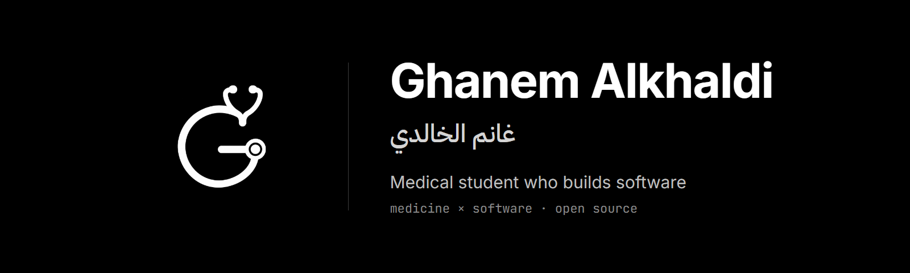

  

I'm a medical student at Jordan University of Science and Technology, and I've been writing code since I was a
kid. I work where the two meet: software that helps people learn medicine, and the tools that keep that software
running.

### What I'm building

- **[Syaq](https://syaq.xyz)** (أكاديمية سياق): a medical-education platform in Arabic and English, on iOS,
  Android and the web. Every course is built from lectures, and each lecture holds its videos, annotated PDFs,
  quizzes and flashcards in one place.
- **[Database Manager for VitoDeploy](https://github.com/Ghanemalk/vito-database-manager)**: an open-source plugin
  that puts a full database client inside the [Vito](https://vitodeploy.com) server panel. Browse and edit rows,
  change structure, run SQL and watch live queries on MySQL, MariaDB and PostgreSQL.

### What I work with

TypeScript · React Native (Expo) · PHP · SQL (MySQL, MariaDB, PostgreSQL)

### Support my work

If my open-source work helps you, you can [sponsor it on GitHub](https://github.com/sponsors/Ghanemalk).
